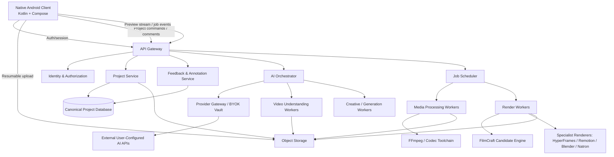

# AIVX — System Architecture and Technical Design

**Document ID:** AIVX-ARCH-001  
**Version:** 1.1 · **Date:** 2026-11-27 (Asia/Dhaka)  
**Status:** PROPOSAL — not yet approved as a deployable cloud design  
**Phase:** D — Technical Design  
**Related IDs:** ADR-001..ADR-018, FEAT-01..FEAT-15, FR-001..FR-053 (41 defined), NFR-001..NFR-015, DATA-001..DATA-024, API-001..API-045, SEC-001..SEC-030, TEST-001..TEST-088 (see `docs/TEST_REGISTER.md`), TEST-ARCH-001..TEST-ARCH-007, RISK-001..RISK-032

## 1. Purpose and non-negotiable constraints

AIVX is a private, online-only, native Android video-editing application with AI-assisted generation, reverse engineering and editing. The Android app is the user-facing editor surface. The authoritative project state and all expensive media processing run on authenticated cloud services. The Android APK must not contain privileged provider keys, cloud service-account credentials, FFmpeg binaries, CUDA runtimes, model checkpoints, or a second shadow copy of canonical project state.

**APPROVED:** native Android; Kotlin + Jetpack Compose preferred; online-only workflow; user-provided provider credentials; prompt-based editing; visual circle/point/range comments; batch execution after reviewing all comments.  
**PROPOSAL:** cloud control plane + canonical project API + object storage + job workers + provider gateway + rendering services.  
**OPEN:** cloud vendor, region, database, object store, billing ceiling, GPU availability, authentication method, data retention, and final NLE engine.

## 2. Logical architecture

## 3. Major services and ownership

### 3.1 Android Client — native only

Responsibilities: sign-in UI; private workspace/project navigation; upload queue; media bin; playback/preview; timeline interaction; layer inspector; drawing annotation tools; comment list; natural-language prompt editor; AI proposal diff; batch approval; render queue; export download; offline/error UI; accessibility and device adaptation.

The client sends commands and renders server-provided project snapshots. It may keep a cache for responsiveness, but every edit must be reconciled against server version and command response. Cached state is never authoritative. Android-specific media APIs may be used for playback and platform UI, but not as a substitute for the cloud renderer or canonical editor model.

### 3.2 API Gateway / Control Plane

Responsibilities: authenticated API routing; request IDs; rate limiting; payload validation; idempotency; API versioning; authorization checks; job creation/status/cancellation; signed upload/download URLs; safe error mapping; audit events. Public APIs must never expose arbitrary filesystem paths or shell commands.

### 3.3 Identity and authorization

The private app still needs proper identity. An account may belong to the owner or an invited friend. Project roles are minimal: `OWNER`, `EDITOR`, `COMMENTER`, `VIEWER`. Role capabilities are enforced server-side. Invitation flow and account recovery remain OPEN. No project or media is public by default.

### 3.4 Project Service

Owns the canonical, versioned project document and its command journal. Validates commands, checks lock/version conflicts, applies one atomic command or batch, records before/after revisions, supports undo/redo through inverse commands or snapshots, emits change events, and creates immutable render snapshots. It rejects invalid media ranges, unknown layer IDs, invalid keyframes, out-of-bounds masks and unsupported engine features.

### 3.5 Feedback / Annotation Service

Stores visual comment anchors with sequence time, source frame/time, normalized coordinates, object/track/layer/clip/asset references, selected region geometry, text OCR/vision hints, capture metadata and project revision. On every comment write it records the exact project revision and a compact context snapshot so that later timeline edits cannot silently change what the comment refers to.

### 3.6 AI Orchestrator

Turns prompts and saved comments into structured, typed edit plans. It selects tools based on capability manifests; asks for missing details only where necessary; retrieves relevant frames/audio/transcripts; invokes VLM/ASR/OCR/object segmentation workers; converts user intent to operations; validates them against project schemas; estimates uncertainty/cost; prepares dry-run changes; asks for approval; executes an atomic batch; verifies the actual render; and produces a report. The LLM never directly writes arbitrary project JSON or executes arbitrary code.

### 3.7 Provider Gateway / BYOK vault

Stores user-configured API profiles encrypted server-side. It normalizes protocol differences only where an adapter exists. Every provider adapter declares: endpoint base URL; auth type; secret reference; required headers; request schema; response parser; streaming support; model ID; supported input types; video/audio/image context limits; maximum file size; timeout; retry policy; region; retention notes; estimated token/frame pricing; rate limits; error mapping. A custom adapter must be explicitly configured and tested. “OpenAI-compatible” is a protocol family, not proof that every custom model implements every feature.

### 3.8 Storage

Object storage contains source media, derived proxies, thumbnails, waveforms, extracted frames, OCR/transcripts, mask sequences, render caches, exports, model reports, and snapshots. Project metadata in the database points to versioned object IDs, never raw user-supplied URLs as trusted paths. Use signed, short-lived scoped URLs for uploads/downloads. Lifecycle deletion must account for versions, derived objects and backups.

### 3.9 Job scheduler and workers

Long jobs are asynchronous and checkpointed. Worker classes: `MEDIA_PROBE`, `PROXY`, `FRAME_EXTRACT`, `SCENE_DETECT`, `ASR`, `OCR`, `VLM_ANALYSIS`, `TRACKING`, `SEGMENTATION`, `INPAINT`, `UPSCALE`, `INTERPOLATION`, `STABILIZATION`, `3D_RENDER`, `COMPOSITE`, `FINAL_RENDER`, `QC`, `EXPORT_ADAPTER`. Jobs need queue limits, cancellation, retry bounds, idempotency, resource class, max duration, cost ceiling and isolated temporary workspace.

## 4. Canonical editing engine strategy

**Primary candidate:** `storytold/filmcraft` headless Rust NLE. Its architecture documents an engine-first session/command model, exact integer ticks and rational frame rates, a CPU-reference/GPU-fast-path renderer, project schema versioning, undo, scopes, codecs and multiple interchange formats. Its current repository README/docs are evidence of design, not proof that it compiles on our cloud target or fits our data model. `filmcraft-desktop/filmcraft` *(non-catalogue disambiguation target; `NOT VERIFIED`; not counted in the 412 occurrence rows or 264 unique catalogue identities)* has a similar architecture tree and should not be assumed identical to `storytold/filmcraft`; the latter has the more extensive architecture/testing/project-files/interchange documentation fetched for this review.

**Gate before adoption:** pin commit; inspect full source and licence/configs; build server-side on intended Linux image; run `cargo xtask ci`; validate codecs; test headless project creation/import/trim/keyframe/mask/audio/mix/preview/render/cancel/undo/redo/persistence/reopen; benchmark 1080p and 4K; check RAM/GPU use; validate concurrent sessions; prove deterministic operation; create an adapter to AIVX canonical schema or formally select FilmCraft `.fcproj` as canonical. No decision to replace the app-wide schema with FilmCraft has been made.

**Media foundation:** FFmpeg/ffprobe are the codec, probing, decode/encode and filter tools. They are not the project model or user experience. A media worker must validate all input paths, stream metadata, durations, timestamps, color metadata, audio tracks, VFR/CFR and resource requirements before processing.

**Specialist tools:** Remotion/HyperFrames for deterministic code-generated motion; Blender for 3D; Natron/OpenFX for specialist compositing; SAM2/Track-Anything/RAFT for segmentation/tracking/flow; ProPainter for inpainting; RIFE for frame interpolation; Gyroflow for stabilization; Real-ESRGAN/GFPGAN/waifu2x for optional restoration. Each remains an isolated worker behind typed API contracts. Tool output is flattened or translated into editable layer objects where possible; unsupported generated media is clearly labeled as a raster/video layer.

## 5. Time, frame and color invariants

- Store timeline positions in exact integer ticks or rational frame/sample coordinates. Avoid iterative floating-point seconds in timeline operations.
- Store source-media PTS/timebase separately from sequence/timeline time.
- Support variable-frame-rate sources using actual presentation timestamps; do not assume one constant frame interval for all source files.
- Audio sample positions use sample indices and sample rate; synchronize audio to video with explicit conversion rules.
- Display timecode is a formatted view, not a database key.
- Sequence settings explicitly contain width, height, pixel aspect ratio, frame rate, color space, transfer function, bit depth and audio sample rate.
- Preview proxy quality can differ from final render quality, but geometry/timing must be consistent and any quality differences declared.
- Color transforms must declare input/output spaces and order; never silently apply unknown LUTs.

## 6. Rendering and preview

Preview is a separate quality tier from final render. The system should support low-resolution interactive proxy preview, paused-frame high-quality preview, review render, and final render. Final render reads an immutable project revision. Render jobs return progress, logs with redacted values, per-segment cache metrics, exact render settings and an output manifest. Export cancellation must clean temporary work without deleting the project or source media.

## 7. Cloud deployment model — not yet chosen

Google Cloud is a plausible option because the user plans to use Google AI Studio, but vendor lock-in and cost should be compared before selection. Possible components include Cloud Run for API/control services, Cloud Run Jobs or a queue-backed worker for batch work, Firebase Auth, Firestore or SQL for project metadata, and Cloud Storage for media. Cloud Run GPU capability and quotas vary; GPU instances have minimum CPU/RAM shapes and are paid resources. Firebase Cloud Storage currently requires a Blaze billing account. No billing, card or deployment assumption is made.

## 8. Failure isolation and consistency

- A failed AI model must not corrupt the project document.
- A worker retry must be idempotent; use `job_id + operation_id` deduplication.
- A batch has `PREPARED → AWAITING_APPROVAL → APPLYING → VERIFYING → COMMITTED` or `FAILED/ROLLED_BACK` lifecycle.
- Conflicting comments must be surfaced; never silently choose last-write-wins for overlapping geometry/text operations.
- If project revision changed since comment capture, run anchor re-resolution and show a conflict report.
- If an external provider times out after receiving an expensive request, use provider task IDs/recovery where supported; otherwise require explicit user choice before retry.

## 9. Architecture decisions still OPEN

Cloud vendor/region; database; media store; worker runtime; queue; authentication; project retention; engine selection; provider gateway implementation; cost controls; external formats priority; preview transport; and cloud GPU policy.

## 10. Acceptance gates

`TEST-ARCH-001`: native Kotlin/Compose project successfully created in the actual AI Studio account.  
`TEST-ARCH-002`: Android client authenticates and calls a non-paid health endpoint.  
`TEST-ARCH-003`: resumable upload to private bucket works with authorization; storage billing approval is recorded.  
`TEST-ARCH-004`: worker can probe a sample video and report codec/size/duration/FPS/VFR/audio/color metadata.  
`TEST-ARCH-005`: canonical project revision increments atomically under concurrent edits.  
`TEST-ARCH-006`: API keys never appear in APK, network response to client, logs or crash reports.  
`TEST-ARCH-007`: render job can be cancelled and retried without duplicate project mutations.

## 11. Current Google/Firebase/Cloud Run facts checked 2026-11-26

- Google AI Studio Build mode's current documentation describes both web application builds and native Android builds using Kotlin + Jetpack Compose. It describes a browser-based Android emulator, physical-device installation using browser ADB, a Code view and GitHub import in Build mode. The exact controls and access are still account/session-dependent and must be confirmed inside the user's session before work begins. Source: https://ai.google.dev/gemini-api/docs/aistudio-build-mode
- The same documentation distinguishes the web Build runtime (React client + Node.js server runtime) from Android Build output (Kotlin/Compose native project). AIVX deliberately keeps its production backend separate from the Android app and does not assume that Android Build mode provides a deployable private video-processing server.
- Firebase Cloud Storage requires the Firebase project to be on the pay-as-you-go Blaze plan. Google states that no-cost usage may still be available within the plan, but Spark-plan projects do not have access to Cloud Storage buckets. Therefore a linked billing account is a prerequisite even when use is expected to remain within no-cost allowances. Source: https://firebase.google.com/docs/storage/faqs-storage-changes-announced-sept-2024
- Cloud Run GPU services are currently documented for NVIDIA L4 and RTX PRO 6000 Blackwell. L4 requires at least 4 CPU and 16 GiB RAM; full RTX PRO 6000 requires 20 CPU and 80 GiB RAM. GPU services require billing to be enabled, GPU quota, and instance-based billing configuration; the service can scale to zero when idle. GPU work is therefore not treated as free or automatically approved. Source: https://docs.cloud.google.com/run/docs/configuring/services/gpu

These facts are current-source evidence, not a commitment to use Google Cloud. Verify product availability, quotas, billing, region and cost again immediately before selecting a cloud architecture.
