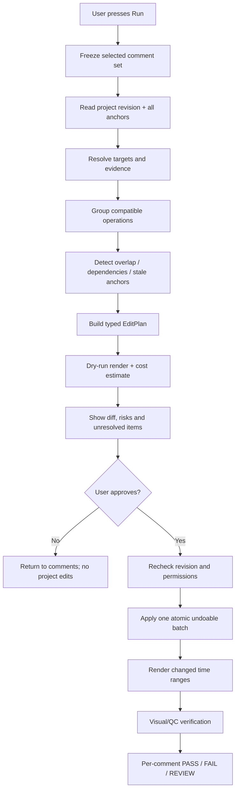

# FEAT-15 — Visual Feedback, Region Anchors and Batch AI Revision

**Document ID:** AIVX-FEAT15-001 · **Version:** 1.1 · **Date:** 2026-11-27 (Asia/Dhaka)  
**Status:** APPROVED PRODUCT REQUIREMENT; detailed interaction and backend design PROPOSAL  
**Priority:** P0/P1 differentiator  
**Related:** FEAT-15, FR-020..029, SCR-08, SCR-09, DATA-011, DATA-012, DATA-014..016, DATA-018..022, API-021..030, SEC-009..015, TEST-041..052 (agent batch protocol: TEST-053..059), ADR-006

## 1. User problem

A user is watching a video in the preview and notices a small problem: for example, the third of three text items visible at 4.0 seconds uses the wrong font. The user should not need to take a screenshot, crop it, upload it, re-explain the time, identify the target or explain the project layers. They should mark the target directly on the current frame and write a short instruction. The system captures enough context automatically to resolve what the user meant.

The user may add many notes at different moments and then run all requested changes once. The comments are individual records, not one long prompt string that loses target identity.

## 2. Interaction model

The preview offers a small feedback tool palette:
- `POINT`: tap an element or point.
- `CIRCLE`: draw an ellipse/circle around an object.
- `LASSO`: freehand region polygon.
- `RECT`: rectangular region.
- `ARROW`: pointer annotation plus optional target region.
- `TIME_RANGE`: mark an interval on the timeline or by dragging across playback.
- `LAYER_PICK`: tap a visible editable object if the renderer exposes hit-test IDs.

The user can pause or select a frame; tool overlay must not change the rendered video. After drawing, a compact composer appears anchored to the marked region. User adds natural-language note, optional priority and save. The UI immediately adds a comment chip/card showing time, target hint and status. The user can continue playback and add more comments without leaving the preview.

## 3. Automatic evidence capture

For each annotation, capture:
1. `projectId`, `sequenceId`, `projectRevision`, `previewRenderId`, `rendererVersion`.
2. Sequence `frameIndex`, `timelineTime`, `frameRate` numerator/denominator and exact rational/tick form.
3. Source `assetId`, source PTS/timebase and source time if current frame maps to one source clip.
4. Stage geometry: original stage width/height, normalized polygon/ellipse/rectangle points, viewport-to-stage transform, preview scaling and letterbox/crop offsets.
5. Selected hit-test targets (clip/layer/text/effect/mask IDs) and their visible bounding boxes if the renderer exposes them.
6. A frame reference or secure server-side render reference; optional low-resolution crop derived on the server. Avoid duplicate full-resolution uploads from the Android phone.
7. Existing OCR/text boxes, object detections, mask/tracking IDs and transcript context when available.
8. User text instruction, locale, comment order, priority and capture timestamp.
9. A context summary that distinguishes observed metadata from AI-detected suggestions and uncertainty.

No image is silently transmitted to an external model. The system must disclose which provider receives the frame/crop and require consent under the project’s media policy.

## 4. Target resolution

Resolution order:
1. Exact renderer object hit-test ID if user tapped a native element.
2. Intersect selected normalized region with visible layer geometry at selected time.
3. Match text OCR boxes to editable text layers using text similarity, font/layout and temporal overlap.
4. Match object segmentation/tracking IDs to media layers and masks.
5. Ask VLM to describe candidates or distinguish visual targets only when needed.
6. If several candidates remain plausible, show a candidate picker; do not choose silently.

A target resolution result includes `targetType`, `targetId`, `candidateIds`, `confidence`, `evidenceRefs`, `editableState`, `timeSpan`, `geometry` and `resolutionMethod`. If no safe editable target exists, mark `UNRESOLVED` and explain why.

## 5. Raster vs editable content handling

- If target is a native text layer: update font family/weight/size, color, tracking, leading, stroke/shadow and keyframes as directed.
- If text has been flattened into video pixels: OCR can identify visible words/region, but cannot recover the original font file or text layer. The system may propose mask/inpaint to remove old text and create a new native text layer. Label this `RECONSTRUCTED_EDITABLE`, show seam/occlusion risk and require review.
- If the target is a generated video model clip: regenerate only the relevant segment if model supports it, or composite an editable overlay. Never claim the original generated clip’s internal elements are structurally editable.
- If font/asset unavailable: show fallback font or request a replacement selection. Do not silently substitute a near font while saying exact match.

## 6. Comment data and lifecycle

Statuses: `OPEN`, `RESOLVING`, `RESOLVED`, `NEEDS_CLARIFICATION`, `READY`, `IN_BATCH`, `APPLIED`, `VERIFIED`, `FAILED`, `CONFLICTED`, `IGNORED`.

Each comment is independently editable, movable on timeline, re-anchorable, duplicable and resolvable. Deleting a comment does not delete source media or project objects. Marking resolved is not the same as applying a change.

If the project changes after the annotation, preserve the original captured revision. Re-resolve by stable layer ID plus time/geometry. If the target moved or was deleted, show `CONFLICTED` and provide re-anchor options.

## 7. Batch Run pipeline

### 7.1 Planning rules

- Freeze comment IDs/order and project revision for one batch.
- Group edits only when they target same compatible object/property/time span.
- If comments conflict (e.g. change text color to red and later blue), show a conflict and ask which wins or apply explicit order if the user specified order.
- If edits depend on one another, compute a dependency graph and show execution sequence.
- If an AI proposal touches objects outside marked time/range/target, flag it as scope expansion and require separate approval.
- Generate a dry-run summary containing operation list, before/after preview, target/time, confidence, external service, estimated/actual cost, destructive/inpaint/generation step, and rollback availability.
- No spend-incurring external request until the approval policy is satisfied.

### 7.2 Atomicity and rollback

All approved commands execute within one batch transaction. If a command fails before commit, no partial project revision becomes visible. If rendering/QC fails after the project mutation committed, keep the project change, report the render/QC failure, and offer undo; do not automatically discard a valid project edit because a preview worker crashed. A user-visible `Undo Batch` must restore the exact previous project revision.

## 8. Example

Project revision 23; sequence 30fps; the user circles a text line at 4.0s and comments “change this font”. The anchor resolves to `textLayerId=txt_03`, native editable, confidence 0.99. At 5.0s they mark background and comment “make the background darker”; target resolves to `clip_04` background layer, confidence 0.93. At 8.2s they mark a flattened logo and comment “replace logo”; OCR/vision classifies raster-only, so planner proposes inpaint + editable SVG overlay, confidence 0.72, risk medium. Run produces three operations in one plan. The user can approve all or exclude the logo. Execution reports per-comment status and a batch undo operation.

## 9. Acceptance tests

- TEST-041: Circle on known native text layer at a fixed frame resolves to correct layer ID and time within one sequence frame.
- TEST-042: Rectangle/lasso geometry remains correct under preview scaling, letterboxing, rotation and device DPI.
- TEST-043: User can add at least 20 independent comments without screenshot upload or losing captured timestamps.
- TEST-044: Comment context stores project revision and asset/layer IDs, not only natural-language text.
- TEST-045: A text-target comment changes only the selected text layer and keeps its track/timing intact.
- TEST-046: Raster-only text is not misrepresented as editable text; it offers reconstructed-layer workflow with warning.
- TEST-047: Conflicting comments are surfaced before approval.
- TEST-048: User declines plan; no project revision or provider job is created.
- TEST-049: Approved batch applies as one undoable operation group.
- TEST-050: Worker failure during pre-commit causes no partial project mutation.
- TEST-051: Project revision changes between annotation and Run; stale anchors are revalidated and conflicts displayed.
- TEST-052: Post-batch visual comparison inspects the marked time/range and returns evidence-backed verification.
